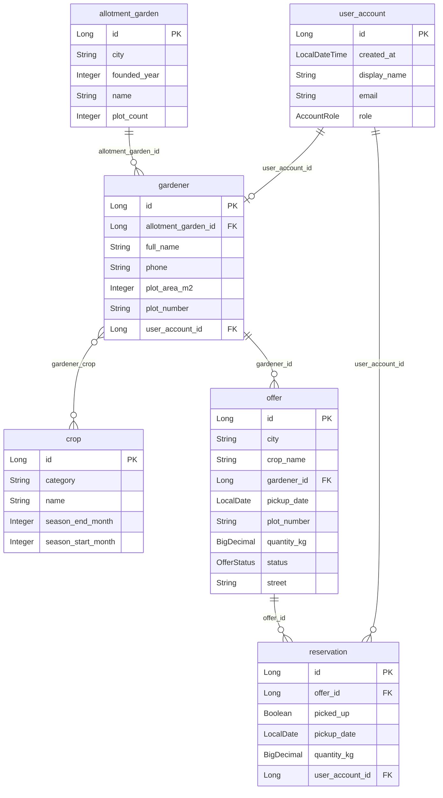

# Schemat bazy danych

Plik generują reguły projektu (panel Maven → Lifecycle → verify). Nie edytujcie go ręcznie.

Tabele: 7 (w tym tabele łączące @ManyToMany: gardener_crop) · kolumny: 37 · relacje: 4 × @ManyToOne, 1 × @OneToMany, 1 × @OneToOne, 1 × @ManyToMany

| Tabela | Encja | Kolumny | Klucze obce |
|---|---|---|---|
| allotment_garden | AllotmentGarden | 5 | — |
| crop | Crop | 5 | — |
| gardener | Gardener | 7 | allotment_garden_id, user_account_id |
| offer | Offer | 9 | gardener_id |
| reservation | Reservation | 6 | offer_id, user_account_id |
| user_account | UserAccount | 5 | — |

